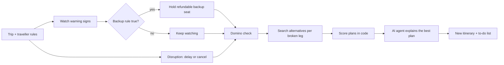

# Reroute

**An AI agent that fixes the whole trip when one booking breaks, and starts fixing it before the airline says anything.**

DevHost 2026 · Problem Statement **PS 4.1: AI Agent for Travel Disruption Recovery** · Sahyadri College of Engineering & Management, Mangaluru

---

## Contents

1. [The problem](#the-problem)
2. [What Reroute does](#what-reroute-does)
3. [How it maps to PS 4.1](#how-it-maps-to-ps-41)
4. [How it works](#how-it-works)
5. [Quick start](#quick-start)
6. [Demo walkthrough](#demo-walkthrough)
7. [Architecture](#architecture)
8. [API reference](#api-reference)
9. [Project structure](#project-structure)
10. [Testing](#testing)
11. [What is real and what is simulated](#what-is-real-and-what-is-simulated)
12. [Roadmap](#roadmap)

---

## The problem

A trip is a chain. Meera flies from Mangaluru to Bengaluru, takes a cab to a hotel, catches a train to Mysuru in the morning and has a paid palace tour at 10:30.

When her flight is cancelled, the flight is only the first thing to break:

- the cab driver waits and charges a no-show fee,
- the hotel marks her as a no-show and charges the night,
- she misses the morning train,
- she misses the tour she already paid for.

Existing tools handle one link of this chain. Airlines rebook the flight and ignore everything else. Flight trackers warn you, but do not book anything. Most "disruption guarantees" only start after the airline announces the problem, and by then the cheap alternative seats are gone.

## What Reroute does

Reroute looks at the **whole itinerary** and does two jobs.

**1. Recover the whole trip.** When something breaks, Reroute finds every other booking that breaks because of it (the *domino check*), searches alternatives for each broken leg, scores complete recovery plans against the traveller's own rules (budget, arrival deadline, no road travel at night), and shows a new itinerary with a to-do list.

**2. Act early, but only in ways that can be undone.** Before any announcement, Reroute watches warning signs such as the incoming aircraft failing to land, or heavy rain in the airport weather report. As the chance of cancellation rises, it can hold a **backup seat that is free or cheap to cancel**. If the flight goes fine, the backup is cancelled and the traveller loses nothing.

The AI agent explains, compares and drafts. It does not decide prices, times or spending. Those come from code and data.

### Why act early

By the time an airline cancels, every traveller on that flight is searching for the same seats. Holding a refundable backup a few minutes earlier turns "everything is sold out" into "Plan A is already secured."

## How it maps to PS 4.1

| Suggested deliverable | Where it lives in Reroute |
|---|---|
| Detects or simulates travel disruptions and identifies affected bookings | **Simulator** page (delay flight, cancel flight, cancel train) + the domino check in `cascade.py` |
| AI-driven alternative search and decision flow under constraints such as budget, timing or destination | Plan search and scoring in `ranker.py`, driven by the traveller's rules; the **Gemini tool-calling agent** in `agent.py` |
| Recovery itinerary showing proposed changes and actions the traveller must take | **Plans** page: three ranked plans, each with cost, time, rules broken and a to-do list; **Trip** page shows the new itinerary after you apply one |
| *Beyond the brief* | **Risk** and **Backups** pages: early warning, a transparent backup rule, undoable holds |

## How it works



### 1. The domino check (`cascade.py`)

Every booking lists the booking it depends on (`depends_on`). For each link, Reroute computes the spare time:

```
spare time = next booking's start − (this booking's end + minimum connection time)
```

When a booking moves, the new time is pushed down the chain. A spare time below zero means the booking is **broken** (red); under 30 minutes means **at risk** (amber). Every status comes with a plain-language reason, for example: *"Lands 22:10, hotel check-in closes 23:00, only 50 min spare."*

### 2. Plan search and scoring (`ranker.py`)

For each disruption Reroute searches the pretend market data (flights, trains, buses, taxis, hotels) starting from **where the traveller actually is**, combining legs into complete recovery plans. Plans that keep every rule come first; plans that break a rule are still shown, clearly labelled with which rule they break.

Lower score is better:

```
score = extra cost (₹) / 1000  +  1.5 × hours late  +  2 × number of changes  +  3 × night road rides
```

A road ride (bus or cab) breaks the night rule if it is on the road between 23:00 and 05:00, even if it left earlier, unless the traveller allows night road travel.

### 3. The backup rule (`holds.py`)

```
hold a backup when:   chance it breaks × money lost if we wait  >  worst-case cost to cancel the backup
```

| Term | Meaning | In the demo |
|---|---|---|
| chance it breaks | Starts at a 5% base rate; each warning sign adds a weight in log-odds, so the chance always stays between 0% and 100% | 5% → 19% → 39% → 59% → 74% |
| money lost if we wait | Computed by our own planner: cost of the best plan if the seat sells out, minus the cost of the best plan if we hold it | ₹3,910 − ₹2,310 = **₹1,600** |
| worst-case cost to cancel | The cancellation fee that applies after the free-cancel window | **₹100** (free until 20:20) |

On a normal day the rule says wait (`5% × ₹1,600 = ₹80 ≤ ₹100`). After the first go-around it says hold (`19% × ₹1,600 = ₹305 > ₹100`). The rule is plain code, the numbers are shown on the Risk page, and every decision is written to the Log.

Safety limits: each backup may cost at most ₹200 to cancel, and all backups together may block at most ₹5,000.

### 4. The AI agent (`agent.py`)

The agent is a Gemini function-calling loop over five tools. Every tool is plain code that reads real state, so the model never invents a price or a time.

| Tool | What it does |
|---|---|
| `get_status` | What went wrong, which bookings are broken or at risk and why, current rules, any held backup |
| `search_plans` | Search and score recovery plans; with arguments it runs a **what-if** ("what if she spends ₹1,000 more?") without changing the rules |
| `update_rules` | Change the traveller's rules and re-plan, only when the traveller's own message asks for it |
| `recommend_plan` | Recommend one of the real plans, with a one-sentence reason |
| `draft_message` | Draft a short message to the hotel, cab driver, tour operator or family |

**It still works without Gemini.** If there is no API key, if Gemini fails, or if it takes more than about 15 seconds in total, a rule-based run of the same tools takes over. The fallback also honours what the traveller typed: a ₹ amount becomes the budget, "by 11:00" becomes the tour deadline, and "no night travel" or "night travel ok" sets the night rule. The screen shows the "Gemini · model" badge only when Gemini actually answered, and the raw provider error goes to the server log, never to the screen.

## Quick start

**Requirements:** Python 3.10+ and Node 18+.

### 1. Backend (terminal 1)

```bash
cd backend
pip install -r requirements.txt
cp .env.example .env        # Windows PowerShell: copy .env.example .env
python -m uvicorn app.main:app --port 8000
```

Add your free Gemini key (https://aistudio.google.com/apikey) to `backend/.env` as `GEMINI_API_KEY=...`. It is **optional**: without it the agent runs its rule-based fallback and everything else works.

### 2. Frontend (terminal 2)

```bash
cd frontend
npm install
npm run dev
```

Open **http://localhost:5173**. The dev server forwards `/api` to the backend on port 8000.

> The backend does not reload on code changes. After editing backend code, restart it (or start it with `--reload`).

## Demo walkthrough

About two minutes. Press **Reset Replay** (top right) before you start; the simulated clock should read `D1 17:00`.

1. **Trip.** Meera's five bookings, all green. The activity feed shows the backup rule waiting: `5% × ₹1,600 = ₹80 ≤ ₹100 → wait`.
2. **Risk → Play sign.** The incoming plane fails to land and the chance rises from 5% to 19%. The airline board still says **On Time**. The rule box flips to `19% × ₹1,600 = ₹305 > ₹100 → hold` and a seat on the 21:20 overnight train to Mysuru is held. Keep playing signs: 39%, 59%, 74%.
3. **Backups.** The card shows the held seat: ₹0 paid, ₹0 if cancelled before 20:20, at most ₹100 after.
4. **Simulator → Cancel flight → Run scenario.** The board says **Cancelled**. The cab, hotel, train and tour turn red, each with a reason. On **Plans**, Plan A uses the held seat and breaks no rule. Without the hold, that seat is sold out and every plan breaks a rule.
5. **Plans → Ask AI agent.** Watch the tool calls, the recommendation (AI pick) and the drafted messages. Then type *"I can only spend ₹2,000 extra"* and ask again: the rules change and the plans re-sort.
6. **Use this plan.** The Trip page shows the new itinerary with new or backup (blue), kept (green) and dropped (grey) bookings, plus the to-do list.
7. **Reset Replay → Risk → Play sign → False alarm.** The plane lands, the backup is cancelled, and the traveller loses ₹0.

Also try **Delay flight 4 h** and **Cancel train**, and edit the rules on the Trip page (**Save rules**). Changing the rules re-plans: an applied plan is un-applied (the log says so) and the backup seat stays usable. One disruption is allowed per run; press **Reset Replay** to try another.

### The six pages

| Page | Purpose |
|---|---|
| **Trip** | Live itinerary, spend, traveller rules, current status |
| **Plans** | Ranked recovery plans, the AI agent panel, apply a plan |
| **Risk** | Replay warning signs, watch the failure chance, see the backup rule with real numbers |
| **Backups** | Seats held on the traveller's behalf, with capped downside; keep or cancel |
| **Simulator** | Break something (delay flight, cancel flight, cancel train) |
| **Log** | Every action and policy decision, in order |

## Architecture

```
React + Vite  (6 pages, hash routing)
      │  /api  (proxied in dev)
      ▼
FastAPI  (in-memory demo state)
      ├── cascade.py   domino check: spare time, broken / at-risk, reasons
      ├── ranker.py    alternative search + plan scoring
      ├── holds.py     failure chance + backup rule + hold lifecycle
      ├── agent.py     Gemini tool-calling agent  ──►  rule-based fallback
      └── data/        trip.json · options.json · signals.json
```

**Design principle: the AI never spends money.** Plain code computes every price, time, score and backup decision. The model chooses which tools to call, explains the result and drafts messages. If it fails, the same tools run without it.

## API reference

Every route returns the full demo state.

| Method | Path | Description |
|---|---|---|
| GET | `/api/trip` | Current state: trip, rules, timeline, chance, airline board text, latest backup-rule numbers, holds, plans, agent result, log |
| POST | `/api/disrupt` | `{type: "cancel" \| "delay", booking_id, delay_min, at}` → domino check + top 3 plans (one disruption per run) |
| POST | `/api/plans/{plan_id}/apply` | Use a plan → new timeline; the backup seat is marked used only if the plan rides on it |
| POST | `/api/rules` | `{extra_spend_cap, reach_tour_by: "HH:MM", allow_night_road}` → re-plan if anything changed |
| POST | `/api/signals/play` | Play the next warning sign → new chance; holds a backup if the rule is true |
| POST | `/api/holds/{hold_id}/keep` | Keep a backup |
| POST | `/api/holds/{hold_id}/cancel` | Cancel a backup (it is not held again) |
| POST | `/api/false-alarm` | Plane lands → cancel held backups, end the replay, re-check the rule |
| POST | `/api/reset` | Start over |
| POST | `/api/agent` | `{message}` → run the AI agent |

## Project structure

```
backend/
  app/
    main.py        API routes, in-memory demo state, the agent's tools
    cascade.py     domino check
    ranker.py      alternative search + scoring
    holds.py       chance from warning signs + backup rule
    agent.py       Gemini tool-calling agent + rule-based fallback
    config.py      reads backend/.env
  data/            trip.json, options.json, signals.json (simulated data)
  tests/           test_reroute.py
  .env.example     copy to .env and add your key
frontend/
  src/App.jsx      all six pages and their components
  src/main.jsx     mounts the app
  src/index.css    styles
  vite.config.js   forwards /api to port 8000
Reroute-Project-Plan.md   full idea, demo script and Q&A
```

## Testing

```bash
cd backend
python -m pytest -q
```

The tests cover the domino check, scoring, the backup rule and hold lifecycle, input validation and the agent's fallback. They never call Gemini: the Gemini path is tested against a faked HTTP response.

## What is real and what is simulated

| Real, working code | Simulated for a repeatable demo |
|---|---|
| Domino check and dependency logic | Bookings, prices and availability |
| Plan search and scoring | Warning signs and their weights (a prepared replay) |
| Backup rule and hold lifecycle | Backup payments and refunds |
| Agent tool calls, what-if search, rule updates | Airline and operator data |
| Fallback agent that works with no API key | |

Nothing here talks to a real airline, railway or bank. Taking this to production would need live travel data and operators that offer free or cheap cancellation and "block now, charge later" payments.

## Roadmap

- Detect go-arounds from real aircraft position data instead of a prepared replay
- Live airport weather and flight-status feeds
- Learn the warning-sign weights from historical flight data
- Seat-hold limits per train so many travellers cannot hoard the same seats
- Group trips and travellers with different constraints
- Kannada and voice input

---

**Security note:** never commit `backend/.env`. It is listed in `.gitignore`, and `.env.example` holds the empty template.
